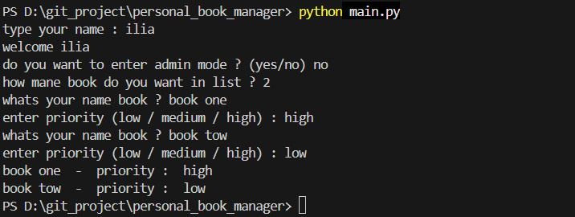
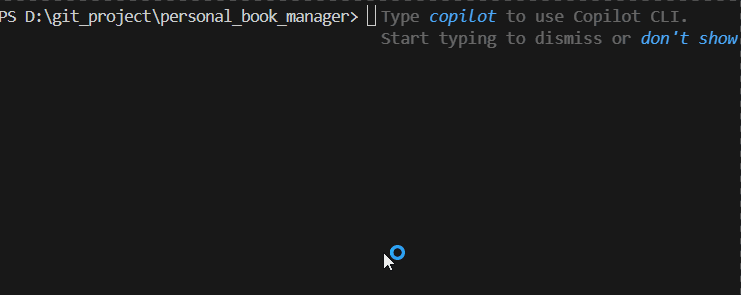

# Personal Book Manager


A simple taak manager built with python 

## Features 
- add multiple books
- save books 
- load saved books 
- admin mode 
- add priority book in main code 

## Project Structure

```text
personal_book_manager/
|   .env.example    
|   .gitignore  
|   books.py    
|   main.py   
|   requirements.txt    
|   README.md   
├───images  
│       Demo.gif    
|       screenshot_1.jpg    
└───
```

| File / Folder | Description |
|---|---|
| `main.py` | Entry point of the program. Handles user input and Admin Mode. |
| `books.py` | Contains the book logic: adding, showing, saving, and loading books. |
| `.gitignore` | Tells Git which files to ignore. |
| `.env.example` | Example of the `.env` file without a real password. |
| `requirements.txt` | List of packages needed to run the project. |
| `images/` | Screenshots used in the README. |
| `Demo.gif` | A short recording of the app in action |
| `screenshot_1.jpg` | An image of how the finished program looks in the terminal |

## How It Works

1. When the program starts, it loads the password from the `.env` file.
2. It asks if you want to open Admin Mode. If you say yes, you must enter the correct password.
3. It asks for your name and shows a welcome message.
4. It reads the previous books from `books.txt` (or `books.json`). If the file does not exist yet, it starts with an empty list.
5. You can add a new book. In the newer version, you also choose a priority (low, medium, high).
6. The program shows all books in a list.
7. When you finish, the books are saved to the file, so they are still there the next time you run the program.

## Troubleshooting

### 1. ModuleNotFoundError: No module named 'dotenv'
- **What it means:** Python cannot find the `python-dotenv` package.
- **Why it happens:** The package is not installed, or it is installed for a different Python version.
- **What to check first:** Run `python -m pip install python-dotenv`, and make sure you run the program with the same Python.

### 2. FileNotFoundError
- **What it means:** The program tried to open a file that does not exist.
- **Why it happens:** The books file has not been created yet (first run) or you are running the program from the wrong folder.
- **What to check first:** Check that your terminal is inside the project folder and that the file name in the code is correct.

### 3. Admin password is not read from `.env`
- **What it means:** The program cannot find the password, so the correct password is rejected.
- **Why it happens:** The `.env` file does not exist, is in the wrong folder, or the variable name differs from the one in the code.
- **What to check first:** Make sure `.env` is in the same folder as `main.py` and the variable name matches exactly.

### 4. Wrong Python version
- **What it means:** The program runs with an older Python than the one you installed packages in.
- **Why it happens:** Your computer has more than one Python, and the terminal uses a different one.
- **What to check first:** Run `python --version` and compare it with the version you expect.

## Priority Book 
Prioritizing books at 3 levels : 
- high
- medium 
- low 

## Requirements
- Python 
- pyhton-dotenv

## Installation
Install the required paskages : 
```bash
pyhton -m pip install -r requirments.txt
```
## Envoirment Setup 
create a `.env` file in the project folder 

Ues `.env.example` as a template 

Add your admin password 

```env 
BOOK_MANAGER_ADMIN_PASSWORD=your_password_here_for_admin
``` 
replace `your_password_here_for_admin` with your own admin password 

## Run the Program 
run the main file : 
```bash 
python main.py
``` 
## Screenshot 
 

## Demo 
 
